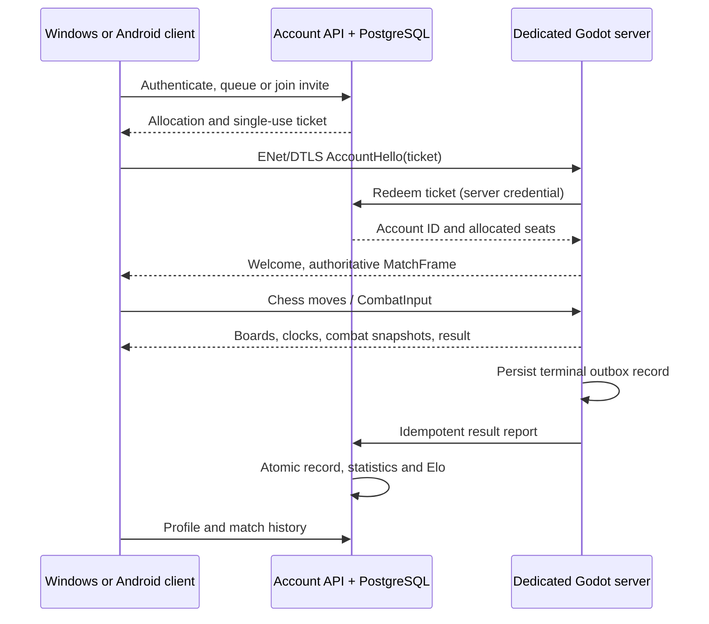

# Native application integration

Baseline: `origin/develop` b4c6dab plus reviewed, unmerged native multiplayer PR5
0086ebb and latest Claude combat/audio/mobile handofff8128cc. This branch preserves their gameplay
and the legacy React/Capacitor game. New work remains Codex-owned; no combat
simulation, assets or animation files change.

## Trust and state

The Godot application is a presentation client. `ui/application.tscn` handles
navigation, account requests and matchmaking. Local play opens the original
Classic/Battle scene with a stored launch configuration. Allocated online play
opens the original online lobby, with its original board projections and
presentation-only combat arena. Each device owns its settings and 2D/3D view;
these are never matchmaking criteria or authoritative match state.

The Node account service owns identities, sessions, queues, private codes,
records, ratings and leaderboards. PostgreSQL is required in production;
SQLite gives a reproducible local setup. Passwords use salted scrypt and account
tokens are stored hashed. The application keeps bearer credentials in memory;
players sign in with the same username and password on either native platform.
The API has bounded bodies, sign-in concurrency and request limits. Deploy it
behind HTTPS with a private database and a separate server credential.

The allocation supplies the expected DTLS certificate hostname independently of
the dial address (for example, an IP address with a DNS certificate). Certificate
chain and hostname validation remain enabled; private roots come only from the
authenticated account service.

An allocated player requests a short-lived single-use ticket over HTTPS, then
sends AccountHello over ENet/DTLS. The dedicated server redeems it using its own
backend credential and provisions the exact player IDs, seats and time control.
An account-enabled server rejects anonymous admission and client-created rooms.
The standalone unconfigured server remains available for the existing local
networking tests; it has no competitive rating service. ENet resume tokens are
separate memory-only credentials for reconnecting to the same process.

The dedicated server owns chess, clocks, combat simulation and termination.
Clients send moves or combat input, never trusted damage or winners. Terminal
reports go through a local durable outbox and the authenticated internal API.
A transaction stores the immutable result and changes both ratings once.
Repeated identical reports return the original record; conflicting reports are
rejected. Service aborts are unrated and do not change W/L/D. Active allocations
have a120-second lease renewed every20seconds, including pending terminal
reports. A lost dedicated process that restarts recovers queued terminal reports
and explicitly aborts unfinished matches; it does not restore active combat.
A longer infrastructure outage can expire a lease; a conflicting late report
requires operator review and cannot overwrite the recorded outcome.

## Contracts and ownership

HTTP and additive AccountHello contracts live in
`contracts/application/v1/README.md` and `godot/contracts/application/v1`.
Game and ENetv1 contracts remain compatible. No input-device or presentation
field enters matchmaking. C0 Battle remains untimed, with traditional king
safety/checkmate; the separately proposed royal gauntlet needs a future ruleset.

The service initially configures one dedicated endpoint. FIFO pairing uses exact
mode/ranked/time-control buckets and a widening ranked rating window. This is a
small-scale architecture, not a multi-region orchestrator: use a supervised
persistent dedicated process, persist its outbox volume, protect internal HTTP
routes with a network firewall, terminate HTTPS at the API proxy, enable backups,
and monitor expired leases and conflicting reports. Account password recovery,
email verification and social features are not implemented by this task.
