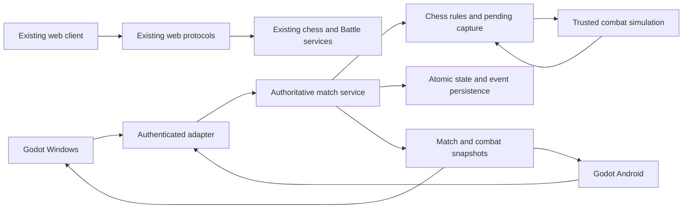

# Architecture decision 001: preserve and migrate incrementally

Status: accepted foundation decision at `c0dfe92`. The native Classic slice
now implements local rules, clocks and both board views; see
[Classic implementation](../classic/CLASSIC.md). References below to the initial
status scene describe the foundation baseline, not the current Classic client.
Native dedicated multiplayer now uses the user-requested ENet/DTLS transport;
see [decision 002](../network/ADR_ENET.md) and [startup/validation](../network/README.md).
The HTTPS/WSS native proposal below records the foundation decision and is
superseded for native clients; existing web transports remain intact.

The existing web application is the working reference. The new Godot application
lives in `godot/` and initially contains a runnable status scene and contract
codec/tests. It does not yet play chess. No web route, server API, Android
package, save key or existing asset is replaced by this task.

## Authority and boundaries

One authoritative match service owns identity-to-seat binding, legal moves,
FEN/history, clocks, draw/mate adjudication, pending capture, persistent commits
and monotonically increasing board revisions. Online clients submit intent.
They cannot set FEN, HP, damage, clocks, ratings, or winners. Offline play uses
one local authority behind the same boundary, without claiming online security.

The combat authority receives a validated BattleRequest, runs fixed 60 Hz
simulation and emits CombatSnapshot/BattleResult. Claude owns combat code;
Codex owns hosting and the adapter that accepts its result exactly once.
The server constructs the request from its own board, registry and balance
configuration. The trusted simulation runs inside the server process or an
authenticated server worker; a client-sent BattleResult is always forbidden.

The chess authority freezes the board during combat. A valid result commits
one chess ply atomically, updates registry/history/draw state and publishes a
MatchState. Result presentation cannot decide or delay authority indefinitely.
Quiet moves bypass combat. Classic never enters combat. Both board views are
projections of the same state and never own separate move rules. Third-person
combat is a separate scene, regardless of the chosen chessboard view.

The native adapter exchanges v1 payloads over ENet/DTLS. Existing web protocols remain live
code paths and do not exchange that native protocol. Native/web crossplay
requires explicit translation and server deployment, not just common JSON.

## Transport and hosting decision

Initially preserve Node/chess.js as the reference rules authority. Godot cannot
import TypeScript; port rules only with move-generation parity/perft coverage.
Use authenticated HTTPS/WSS JSON for a first native adapter so Windows and
Android can reach the same server. Godot ENet RPC is not wire compatible with
existing WebSockets/PeerJS. Native clients need their own credential storage;
never embed server credentials. TLS termination and reconnect tokens belong to
infrastructure, not combat scenes.

Persistent combat cannot run in short-lived Vercel Functions. A match is pinned
to one process; a future service must persist event/result IDs and pending
captures for recovery. Do not horizontally replicate in-memory rooms without
routing/leases. A restart in the current legacy Battle service loses rooms.
A production reconnect/durability design is a later feature, not completed here.

## Scene and asset boundary

Codex will mount `godot/combat/arena.tscn` through a combat adapter; this path is
a planned convention, not an existing resource reference. Proposed API:
`start_battle(request: Dictionary)`, `submit_input(input: Dictionary)`,
`apply_snapshot(snapshot: Dictionary)`, `stop_battle()`; authority-only signals
`combat_snapshot(snapshot)` and `battle_finished(result)`. The server calls
simulation ticks; clients use apply_snapshot for presentation. Claude must
supply a headless entry point that does not depend on cameras, audio or rendering.
No multiplayer authority is inferred from Godot node ownership alone.

Blender output must be portable glTF/GLB, with +Y up and meter units. Visual rigs
may face -Z; an explicit visual child transform maps to the gameplay heading
specified in CONTRACTS.md. Character IDs reference data, never filesystem paths
supplied by a client. Balance tables are authority-approved, immutable per duel.
